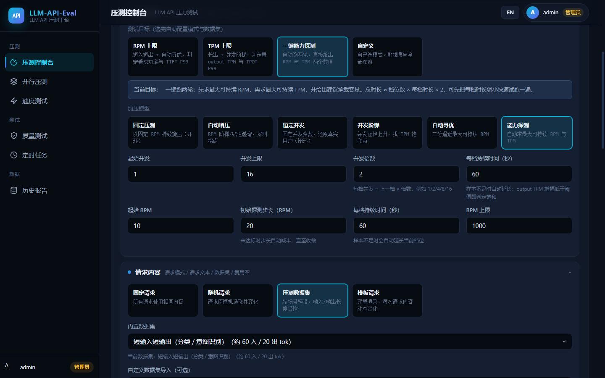
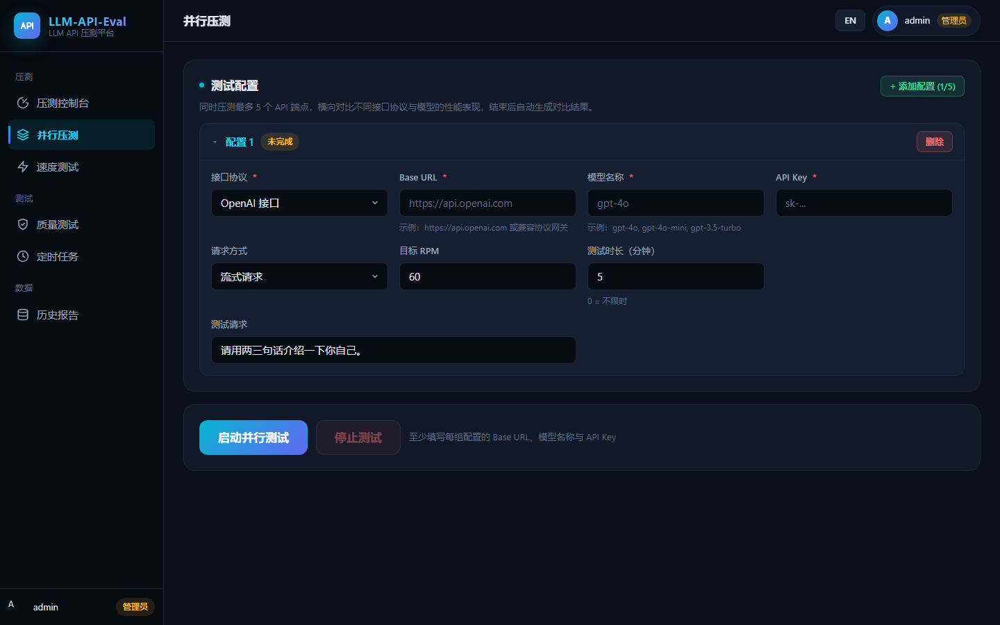
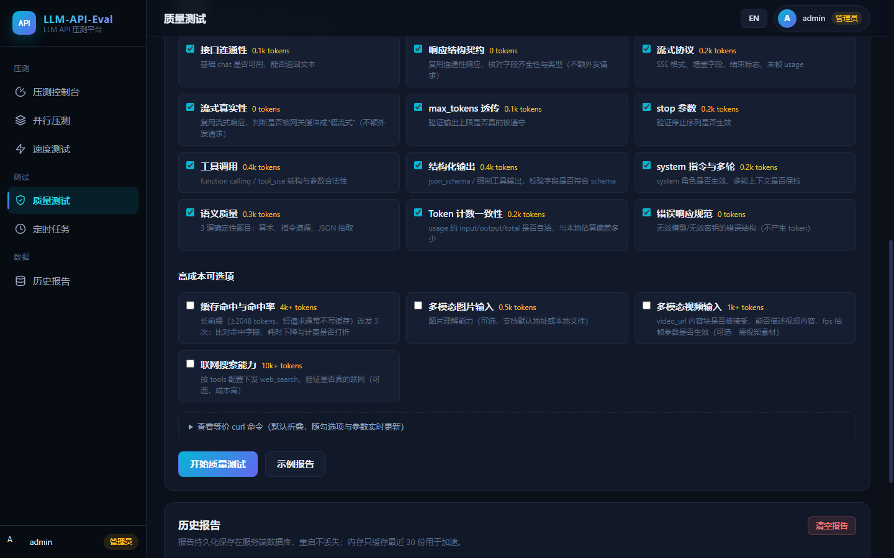

<div align="center">

**简体中文** | [English](README.md)

</div>

# LLM-API-Eval

大模型 API 压测与评估平台。通过 Web 控制台配置被测接口（Base URL / API Key / 模型名），支持 OpenAI、OpenAI Responses、Anthropic、Gemini 四种接口协议，对大模型 API 做 RPM / TPM 压力测试、模型质量评估与解码测速，实时监控成功率、延迟分位数、首字节延迟（TTFB）、每输出 token 耗时（TPOT）等指标，并提供历史记录、A/B 回归对比、成本估算、报告导出、并行对比测试与定时任务。

## 界面预览

**目标与加压模式配置** — 四种接口协议、四类测试目标、六种加压模型，一个控制台全部搞定



**并行对比压测** — 最多 5 组配置同屏竞速 · **质量检查项** — 16 项能力检查一键开测

<p align="center">
  
  
</p>

## 功能总览

### 压力测试

- **多接口协议**：OpenAI Chat Completions（`/v1/chat/completions`）、OpenAI Responses（`/v1/responses`）、Anthropic Messages（`/v1/messages`）、Gemini，支持流式 / 非流式请求，流式请求统计 TTFB
- **六种加压模型**：
  - `fixed` 固定 RPM（开环，可设时长）
  - `auto` 自动增压（阶梯 / 线性递增，探测拐点）
  - `concurrency` 恒定并发（闭环，还原真实用户行为，统计实测达成 RPM）
  - `concurrency-ramp` 并发阶梯（并发逐档上升，寻找 TPM 饱和点）
  - `seek` 自动寻优（二分逼近最大可持续 RPM）
  - `probe` **能力探测**：一键串行跑两轮，直接给出「最大可持续 RPM」与「最大可持续 TPM」及建议承载容量
- **完整的延迟与吞吐指标**：
  - 延迟分位数 P50 / P90 / P95 / P99（基于全量样本直方图，非"最近 N 次"），失败请求单独统计
  - TTFB 分位数（流式首字节延迟）与 **TPOT 分位数**（每输出 token 耗时，解码质量指标）
  - TPM 拆分为**输入 TPM / 输出 TPM / 总 TPM**，并提供**近 60 秒滑动窗口**的实时 TPM
  - 并发指标（峰值并发、平均并发，后者由 Little's Law 推导）与因并发上限跳过的请求数
- **分钟级趋势可视化**：详情页内置折线图，按分钟展示平均响应延迟与 Token 吞吐（总 / 输入 / 输出），用于定位性能拐点与抖动
- **SLA 达标判定**：统一用「成功率下限 + TTFT P99 上限 + TPOT P99 上限」判断某一档位能否承载。RPM 上限看 TTFT（与输出长度无关），TPM 上限看 TPOT（反映解码速度），不再用会被输出长度带偏的"平均响应时间"
- **压测数据集**：8 类场景预设（短入短出 / 长入短出 / 短入长出 / 长入长出 / 多轮 / 结构化输出 / 工具调用等），按目标 token 数控制输入长度；支持 CSV / JSONL / JSON 数组 / 纯文本导入与按 token 数合成请求
- **请求复用率可控**：0% 表示每次全新请求（无前缀缓存命中，反映真实容量），100% 表示反复复用同一批请求（缓存命中，反映性能上限）
- **智能熔断**：成功率低于阈值、连续失败超限、平均响应时间过长时自动停止
- **连通性预检**：正式压测前发一个真实请求，验证 Base URL / API Key / 模型名是否可用，返回 HTTP 状态、耗时、TTFB 与响应预览，避免"配了 10 分钟、跑起来全是 401"

### 成本与对比

- **成本估算**：按「每百万 token 单价」配置输入 / 输出价格，压测过程中实时估算本轮消耗的成本并计入历史记录，用于横向比较不同模型 / 渠道的实际开销
- **A/B 历史对比**：任选两条历史记录逐项对比 14 项指标（请求数、成功率、P50/P95/P99、TTFB、TPOT、TPM、成本、时长等），自动标注每项更优的一侧，适合回归验证「换渠道 / 换模型 / 网关调参前后」的表现差异

### 质量与测速

- **模型质量评估**：以极低成本（默认整轮约 1~2k token）验证中转 / 网关暴露的模型接口在三个层面与官方接口的差异：
  1. 协议契约：入参是否被透传、响应字段是否与官方一致、错误路径是否正确（用无效模型 / 无效密钥探测，不产生 token 消耗）
  2. 特殊能力：工具调用、结构化输出、system 指令、多轮对话
  3. 基础语义质量：确定性题目比对被测与官方对照的回答
- **Token 级速度测试**：单流解码 tok/s（多轮均值）、多路并发聚合吞吐、预填充 tok/s、首 token 延迟，自动生成测速报告并存档

### 平台能力

- **中英双语界面**：顶栏（登录页右上角）一键切换中文 / English，偏好保存在浏览器本地，默认跟随浏览器语言
- **多用户账号**：账号表 + 角色（管理员 / 普通用户），首次启动自动创建默认管理员（`admin` / `admin`）；登录页支持开放注册普通用户，压测记录、质量报告、测速报告、数据集、定时任务按用户隔离，管理员可见全部
- **并行对比**：最多 5 组配置同时压测，横向对比不同接口 / 模型表现
- **定时任务**：支持一次性与 Cron 周期任务，可用于夜间回归
- **报告导出**：PDF / Excel / JSON / CSV 格式压测报告（含分位数、输入 / 输出 TPM、复用率与并发口径）
- **实时监控**：WebSocket 推送统计数据与请求日志
- **API 文档**：内置 Swagger UI

## 快速开始

环境要求：Node.js 20+（本地运行需要；Docker 镜像已内置）。

### 本地运行

```bash
npm ci --omit=dev
npm start
```

访问 `http://localhost:8998`，默认管理员账号为 `admin`，初始密码为 `admin`（可用 `DEFAULT_ADMIN_PASSWORD` 覆盖，登录后请尽快修改）。也可以在登录页点击「注册新账号」自行注册普通用户。从旧版本升级时，若 admin 仍在使用旧的初始密码，服务端会在启动时自动将其重置为新默认值。

### Docker 运行

```bash
docker build -t llm-api-eval:latest .
docker run -d --name llm-api-eval \
  -p 8998:8998 \
  -v $(pwd)/data:/app/data \
  -v $(pwd)/logs:/app/logs \
  llm-api-eval:latest
```

> Windows PowerShell 中 `$(pwd)` 需替换为 `${PWD}`。

### docker compose

```bash
docker compose up -d
```

数据库与日志通过卷挂载持久化在 `./data` 与 `./logs`。

## 环境变量

| 变量 | 默认值 | 说明 |
|---|---|---|
| `PORT` | `8998` | 服务端口 |
| `DEFAULT_ADMIN_PASSWORD` | `admin` | 默认管理员 `admin` 的初始密码，登录后请尽快修改 |
| `NODE_ENV` | `production` | 运行环境 |
| `DB_PATH` | `./data/llm-api-eval.db` | SQLite 数据库路径 |
| `LOG_DIR` | `logs` | 日志目录 |
| `LOG_LEVEL` | `info` | 日志级别 |
| `LOG_RETENTION_DAYS` | `30` | 日志保留天数 |
| `DEFAULT_SUCCESS_THRESHOLD` | `80` | 成功率熔断阈值（%） |
| `DEFAULT_MAX_FAILURES` | `10` | 连续失败熔断次数 |
| `DEFAULT_RESPONSE_TIME_THRESHOLD` | `150000` | 平均响应时间熔断阈值（ms） |
| `STREAM_IDLE_TIMEOUT` | `30000` | 流式响应空闲超时（ms），防止流挂死 |
| `DEFAULT_MAX_IN_FLIGHT` | `512` | 在途请求并发上限 |
| `DEFAULT_PROMPT_POOL_SIZE` | `20` | 请求复用池大小，复用率 > 0 时生效 |
| `DEFAULT_SLA_SUCCESS_THRESHOLD` | `99` | SLA 成功率下限（%） |
| `DEFAULT_TTFT_P99_THRESHOLD` | `1000` | SLA：TTFT P99 上限（ms），用于判定 RPM 上限 |
| `DEFAULT_TPOT_P99_THRESHOLD` | `50` | SLA：TPOT P99 上限（ms/输出token），用于判定 TPM 上限 |
| `DEFAULT_CAPACITY_RATIO` | `0.7` | 建议承载容量的折算比例 |
| `DEFAULT_CONCURRENCY_STEPS` | `1,2,4,8,16` | 并发阶梯默认档位 |
| `DEFAULT_CONCURRENCY_STEP_DURATION` | `60` | 并发阶梯每档持续时间（秒） |
| `DEFAULT_TPM_SATURATION_RATIO` | `0.05` | TPM 饱和判定：吞吐增幅低于此比例即认为饱和 |
| `DEFAULT_PROBE_MAX_RPM` | `1000` | 能力探测 RPM 阶段的上限 |
| `DEFAULT_PROBE_INCREMENT_RPM` | `50` | 能力探测 RPM 阶段的寻优步长 |
| `DEFAULT_PROBE_STEP_DURATION` | `30` | 能力探测每档持续时间（秒） |
| `DEFAULT_PROBE_RPM_DATASET` | `short-short` | 能力探测 RPM 阶段使用的数据集 |
| `DEFAULT_PROBE_TPM_DATASET` | `short-in-long-out` | 能力探测 TPM 阶段使用的数据集 |
| `TOKEN_EXPIRY` | `86400` | 登录令牌有效期（秒） |
| `RATE_LIMIT_MAX` | `100` | API 限流：每时间窗口最大请求数 |
| `PDF_FONT_PATH` | 自动探测 | 可选。PDF 报告导出使用的中文字体路径。默认自动探测系统中文字体（Windows 雅黑/黑体、Linux Noto CJK、macOS 苹方）；TTC 集合字体用「路径\|face名」格式，如 `/usr/share/fonts/xxx.ttc\|NotoSansCJKsc-Regular` |
| `RATE_LIMIT_WINDOW` | `1` | API 限流时间窗口（分钟） |
| `CORS_ORIGIN` | `*` | CORS 允许的源 |
| `WS_HEARTBEAT_INTERVAL` | `30000` | WebSocket 心跳间隔（ms） |
| `DEFAULT_PAGE_SIZE` | `20` | 历史记录默认分页大小 |
| `MAX_HISTORY_RECORDS` | `1000` | 历史记录最大保留数量（0 表示不限制） |

## API 文档

启动后访问 `http://localhost:8998/api-docs` 查看 Swagger 接口文档。

## 目录结构

```
├── server.js            # 应用入口
├── database.js          # SQLite 数据访问层
├── src/
│   ├── config/          # 全局配置
│   ├── controllers/     # 控制器
│   ├── datasets/        # 压测数据集（场景预设 / 导入解析 / 按 token 合成）
│   ├── middlewares/     # 认证 / 限流 / 校验 / 错误处理
│   ├── routes/          # API 路由
│   ├── services/        # 压测引擎 / 质量评估 / 测速引擎 / 并行测试 / 定时任务 / 报告
│   └── utils/           # 日志 / SSE 解析 / 统计（分位数与滑动窗口）/ 连接池 / Cron / PDF / Excel
└── public/              # Web 控制台页面
```

## 用户与数据隔离

| 项目 | 行为 |
|---|---|
| 账号 | 账号表 + 角色（`admin` / `user`），首次启动自动创建默认管理员 `admin` |
| 登录 | 每次登录签发独立令牌，WebSocket 握手必须携带令牌（`ws://host/?token=...`） |
| 数据归属 | 压测记录、质量报告、测速报告、数据集、定时任务、目标预设按用户隔离 |
| 管理员 | 可见并管理全部用户的数据，可在「用户管理」中创建 / 删除用户、调整角色 |
| 任务停止 | 默认只能停止自己启动的任务；管理员可强制停止他人任务 |

安全建议：不要将服务直接暴露到公网；确需公网访问时用反向代理 + HTTPS，并限制来源 IP，同时修改默认管理员密码。

## 一键拿到「支持的 RPM 与 TPM」

控制台选择「测试目标 → 一键能力探测」后会串行执行两轮：

1. **RPM 阶段**：用「短入短出」数据集 + 自动寻优逐级上探，输出**成功率与 TTFT P99 同时达标**的最高 RPM；
2. **TPM 阶段**：用「短入长出」数据集 + 并发阶梯，并发逐档上升，直到 **output TPM 增幅低于阈值**或 TPOT P99 超限，该档吞吐即最大可持续 TPM；
3. 最后给出 `最大可持续 RPM / TPM` 与按比例折算的 `建议承载 RPM / TPM`。

控制台同时保留单维度入口：「RPM 上限」「TPM 上限」各只跑其中一轮，「自定义」则可自由组合模式、数据集与全部参数。

> 为什么 RPM 与 TPM 要用不同的测法：测 RPM 要让瓶颈落在调度 / 排队上（短入短出），测 TPM 要让瓶颈落在解码上（长出）。若两者用同一份负载，测出的"RPM 上限"会被输出长度拖累，数字没有意义。此外本工具**拿不到推理引擎的排队等待时间（waiting）**——第三方网关通常不返回该指标，只能用 TTFT P99 的相对突增作为拐点信号。

## 压测口径说明

压测结果只有标注清楚场景才具备可比性，导出报告与历史记录中都会保留以下口径：

- **输入 / 输出长度**：不同长度压的是不同瓶颈（短请求测调度与 QPS，长输入测 prefill，长输出测 decode 吞吐与 KV Cache），建议先统计线上真实的 input/output token 分布，再按比例构造混合负载
- **请求复用率**：0% 反映无缓存命中的真实 / 最坏情况（用于容量规划），100% 反映缓存命中的上限（用于验证缓存是否生效）
- **加压模型**：开环 RPM 与闭环并发测出的"极限"含义不同，前者是"按此速率注入时的表现"，后者是"服务在 N 并发下的实际吞吐"
- **分位数而非均值**：均值会被长尾掩盖，容量规划应参考 P95 / P99

## 开发

```bash
npm install        # 安装依赖（含 jest）
npm test           # 运行单元测试
npm run dev        # nodemon 开发模式
```
