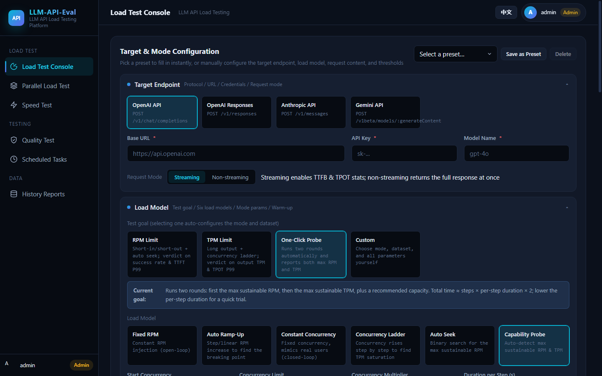
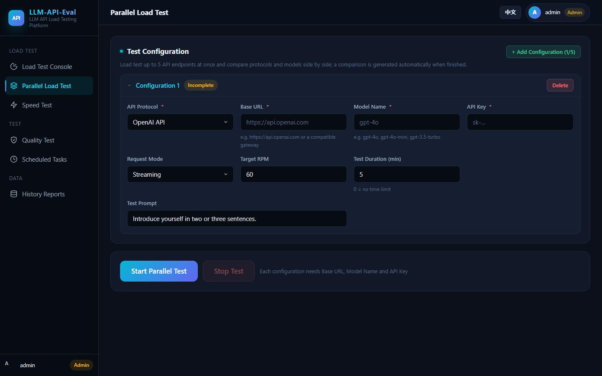
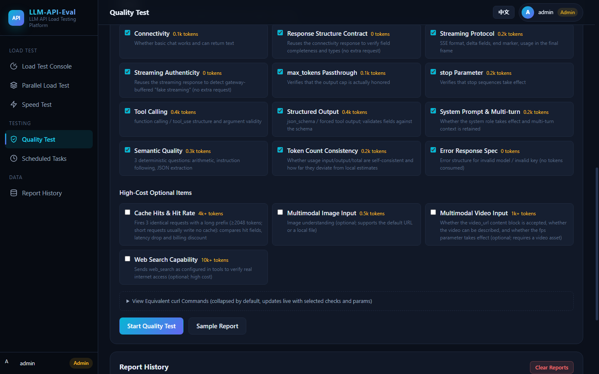

<div align="center">

[简体中文](README-zh.md) | **English**

</div>

# LLM-API-Eval

A stress-testing and evaluation platform for LLM APIs. Configure the target endpoint (Base URL / API Key / model name) in a web console, and run RPM / TPM load tests, model quality assessments, and token-level speed tests against four API protocols: OpenAI, OpenAI Responses, Anthropic, and Gemini. Monitor success rate, latency percentiles, time-to-first-byte (TTFB), and time-per-output-token (TPOT) in real time, with test history, A/B regression comparison, cost estimation, report export, parallel comparison tests, and scheduled jobs.

## Screenshots

**Target & Load Model Configuration** — four API protocols, four test goals, and six load models, all in one console



**Parallel Load Test** — up to 5 configurations racing side by side, and **Quality Checks** — 16 capability checks in one grid

<p align="center">
  
  
</p>

## Features

### Stress Testing

- **Multiple API protocols**: OpenAI Chat Completions (`/v1/chat/completions`), OpenAI Responses (`/v1/responses`), Anthropic Messages (`/v1/messages`), and Gemini; streaming and non-streaming requests are both supported, with TTFB measured on streams
- **Six load models**:
  - `fixed` — fixed RPM (open-loop, with configurable duration)
  - `auto` — auto ramp-up (staged / linear increase to probe the breaking point)
  - `concurrency` — constant concurrency (closed-loop, mimics real users, reports the achieved RPM)
  - `concurrency-ramp` — concurrency ladder (concurrency rises step by step to find the TPM saturation point)
  - `seek` — auto seek (binary search for the maximum sustainable RPM)
  - `probe` — **one-click capability probe**: runs two rounds in sequence and reports the maximum sustainable RPM and TPM, plus a recommended operating capacity
- **Complete latency and throughput metrics**:
  - Latency percentiles P50 / P90 / P95 / P99 computed from a full-sample histogram (not "the last N requests"); failed requests are counted separately
  - TTFB percentiles (streaming first-byte latency) and **TPOT percentiles** (time per output token, a decoding-quality metric)
  - TPM split into **input TPM / output TPM / total TPM**, plus a real-time TPM over a **sliding 60-second window**
  - Concurrency metrics (peak and average concurrency, the latter derived via Little's Law) and requests skipped due to the in-flight cap
- **Minute-level trend charts**: the detail page renders built-in line charts of per-minute average latency and token throughput (total / input / output), useful for locating performance cliffs and jitter
- **SLA verdict**: a load level is judged sustainable by "success-rate floor + TTFT P99 ceiling + TPOT P99 ceiling". RPM capacity is judged by TTFT (independent of output length), TPM capacity by TPOT (reflects decoding speed) — not by "average response time", which output length can distort
- **Test datasets**: 8 built-in scenario presets (short-in/short-out, long-in/short-out, short-in/long-out, long-in/long-out, multi-turn, structured output, tool calling, etc.), with input length controlled by target token count; import from CSV / JSONL / JSON arrays / plain text, or synthesize requests by token count
- **Controllable prompt reuse ratio**: 0% means every request is fresh (no prefix-cache hits, reflects real capacity); 100% reuses the same request pool (cache hits, reflects the performance ceiling)
- **Circuit breaker**: automatically stops when the success rate drops below the threshold, consecutive failures exceed the limit, or responses get too slow
- **Connectivity preflight**: sends one real request before a full test to verify the Base URL / API Key / model name, returning the HTTP status, elapsed time, TTFB, and a response preview — catch a bad key in seconds instead of discovering a wall of 401s mid-test

### Cost & Comparison

- **Cost estimation**: configure input / output prices per million tokens and the platform estimates the running cost of each test in real time and stores it in history, making the actual spend of different models / channels directly comparable
- **A/B history comparison**: pick any two test runs and compare 14 metrics side by side (requests, success rate, P50/P95/P99, TTFB, TPOT, TPM, cost, duration, etc.), with the better side marked automatically — ideal for verifying regressions when switching channels, models, or gateway settings

### Quality & Speed

- **Model quality assessment**: verifies, at very low cost (a full run costs roughly 1–2k tokens by default), that a model endpoint exposed by a gateway differs from the official API on three levels:
  1. Protocol contract: whether parameters are passed through, whether response fields match the official schema, and whether error paths behave correctly (probed with an invalid model / invalid key, which consumes no tokens)
  2. Special capabilities: tool calling, structured output, system prompts, multi-turn conversation
  3. Basic semantic quality: deterministic questions compared between the target endpoint and an official reference endpoint
- **Token-level speed test**: single-stream decode tok/s (averaged over rounds), aggregated throughput under multi-way concurrency, prefill tok/s, and first-token latency, with an archived speed-test report

### Platform

- **Bilingual UI**: switch between Chinese and English from the top bar (or the button on the login page); the preference is saved per browser and defaults to the browser language
- **Multi-user accounts**: user table with roles (admin / user); the default admin (`admin` / `admin`) is created on first start, and open registration is available on the login page. Test history, quality reports, speed reports, datasets, and scheduled jobs are isolated per user; admins can see everything
- **Parallel comparison**: up to 5 configurations tested simultaneously for side-by-side comparison of endpoints / models
- **Scheduled jobs**: one-shot and Cron recurring jobs, suitable for nightly regression
- **Report export**: PDF / Excel / JSON / CSV (including percentiles, input / output TPM, reuse ratio, and concurrency details)
- **Real-time monitoring**: live statistics and request logs pushed over WebSocket
- **API docs**: built-in Swagger UI

## Quick Start

Requirement: Node.js 20+ (local run only; the Docker image ships with it).

### Run locally

```bash
npm ci --omit=dev
npm start
```

Open `http://localhost:8998`. The default admin account is `admin` with the initial password `admin` (override via `DEFAULT_ADMIN_PASSWORD`; change it after the first sign-in). You can also register a regular user via "Register a new account" on the login page. When upgrading from an older version, if `admin` still uses the old initial password, the server resets it to the new default on startup.

### Run with Docker

```bash
docker build -t llm-api-eval:latest .
docker run -d --name llm-api-eval \
  -p 8998:8998 \
  -v $(pwd)/data:/app/data \
  -v $(pwd)/logs:/app/logs \
  llm-api-eval:latest
```

> On Windows PowerShell, replace `$(pwd)` with `${PWD}`.

### Run with docker compose

```bash
docker compose up -d
```

The database and logs are persisted via volume mounts at `./data` and `./logs`.

## Environment Variables

| Variable | Default | Description |
|---|---|---|
| `PORT` | `8998` | Server port |
| `DEFAULT_ADMIN_PASSWORD` | `admin` | Initial password of the default `admin` account — change it after first sign-in |
| `NODE_ENV` | `production` | Runtime environment |
| `DB_PATH` | `./data/llm-api-eval.db` | SQLite database path |
| `LOG_DIR` | `logs` | Log directory |
| `LOG_LEVEL` | `info` | Log level |
| `LOG_RETENTION_DAYS` | `30` | Log retention (days) |
| `DEFAULT_SUCCESS_THRESHOLD` | `80` | Circuit-breaker success-rate threshold (%) |
| `DEFAULT_MAX_FAILURES` | `10` | Circuit-breaker consecutive-failure count |
| `DEFAULT_RESPONSE_TIME_THRESHOLD` | `150000` | Circuit-breaker response-time threshold (ms) |
| `STREAM_IDLE_TIMEOUT` | `30000` | Stream idle timeout (ms), prevents hung streams |
| `DEFAULT_MAX_IN_FLIGHT` | `512` | In-flight request cap |
| `DEFAULT_PROMPT_POOL_SIZE` | `20` | Prompt pool size, effective when reuse ratio > 0 |
| `DEFAULT_SLA_SUCCESS_THRESHOLD` | `99` | SLA success-rate floor (%) |
| `DEFAULT_TTFT_P99_THRESHOLD` | `1000` | SLA: TTFT P99 ceiling (ms), used for the RPM verdict |
| `DEFAULT_TPOT_P99_THRESHOLD` | `50` | SLA: TPOT P99 ceiling (ms/output token), used for the TPM verdict |
| `DEFAULT_CAPACITY_RATIO` | `0.7` | Ratio applied when deriving the recommended capacity |
| `DEFAULT_CONCURRENCY_STEPS` | `1,2,4,8,16` | Default concurrency-ladder steps |
| `DEFAULT_CONCURRENCY_STEP_DURATION` | `60` | Duration of each ladder step (seconds) |
| `DEFAULT_TPM_SATURATION_RATIO` | `0.05` | TPM saturation: throughput growth below this ratio is considered saturated |
| `DEFAULT_PROBE_MAX_RPM` | `1000` | RPM ceiling of the capability probe's RPM round |
| `DEFAULT_PROBE_INCREMENT_RPM` | `50` | Seek step size of the probe's RPM round |
| `DEFAULT_PROBE_STEP_DURATION` | `30` | Duration of each probe level (seconds) |
| `DEFAULT_PROBE_RPM_DATASET` | `short-short` | Dataset used by the probe's RPM round |
| `DEFAULT_PROBE_TPM_DATASET` | `short-in-long-out` | Dataset used by the probe's TPM round |
| `TOKEN_EXPIRY` | `86400` | Login token lifetime (seconds) |
| `RATE_LIMIT_MAX` | `100` | API rate limit: max requests per window |
| `RATE_LIMIT_WINDOW` | `1` | API rate-limit window (minutes) |
| `CORS_ORIGIN` | `*` | Allowed CORS origins |
| `WS_HEARTBEAT_INTERVAL` | `30000` | WebSocket heartbeat interval (ms) |
| `DEFAULT_PAGE_SIZE` | `20` | Default page size of test history |
| `MAX_HISTORY_RECORDS` | `1000` | Max retained history records (0 = unlimited) |

## API Docs

Visit `http://localhost:8998/api-docs` for the Swagger UI after startup.

## Project Layout

```
├── server.js            # Application entry
├── database.js          # SQLite data-access layer
├── src/
│   ├── config/          # Global configuration
│   ├── controllers/     # Controllers
│   ├── datasets/        # Test datasets (scenario presets / import parsing / token-based synthesis)
│   ├── middlewares/     # Auth / rate limit / validation / error handling
│   ├── routes/          # API routes
│   ├── services/        # Stress engine / quality assessment / speed test / parallel tests / scheduler / reports
│   └── utils/           # Logging / SSE parser / statistics (percentiles & sliding window)/ connection pool / Cron / PDF / Excel
└── public/              # Web console pages
```

## Users & Data Isolation

| Aspect | Behavior |
|---|---|
| Accounts | User table with roles (`admin` / `user`); the default admin `admin` is created on first start |
| Login | Each login issues an independent token; the WebSocket handshake requires it (`ws://host/?token=...`) |
| Ownership | Test history, quality reports, speed reports, datasets, scheduled jobs, and endpoint presets are isolated per user |
| Admin | Can view and manage every user's data, and create / delete users or change roles in "User Management" |
| Stopping tasks | By default you can only stop tasks you started; admins may force-stop others' tasks |

Security advice: do not expose the service directly to the public internet. If public access is required, use a reverse proxy with HTTPS, restrict source IPs, and change the default admin password.

## One-Click "Max Sustainable RPM & TPM"

Select "Test goal → One-click capability probe" in the console and two rounds run in sequence:

1. **RPM round**: the short-in/short-out dataset + auto seek climbs step by step and reports the highest RPM where **both the success rate and TTFT P99** stay within limits;
2. **TPM round**: the short-in/long-out dataset + concurrency ladder raises concurrency step by step until **output TPM growth falls below the threshold** or TPOT P99 exceeds its limit; that level's throughput is the maximum sustainable TPM;
3. Finally it reports `max sustainable RPM / TPM` and a `recommended RPM / TPM` scaled by the configured ratio.

Single-dimension entry points remain available: "RPM limit" and "TPM limit" each run one round only, while "Custom" lets you freely combine modes, datasets, and all parameters.

> Why RPM and TPM need different workloads: when measuring RPM, the bottleneck should land on scheduling / queueing (short-in, short-out); when measuring TPM, it should land on decoding (long output). With one shared workload, the "RPM ceiling" gets dragged down by output length and the number becomes meaningless. Also note this tool **cannot see the inference engine's queue-wait time** — third-party gateways usually do not expose it, so a relative jump in TTFT P99 is used as the saturation signal.

## Benchmarking Notes

Test results are only comparable when the scenario is clearly documented. Exports and history records preserve the following details:

- **Input / output length**: different lengths stress different bottlenecks (short requests measure scheduling and QPS, long inputs measure prefill, long outputs measure decode throughput and KV Cache). Ideally, profile your real input/output token distribution first and build a mixed workload around it
- **Prompt reuse ratio**: 0% reflects the real / worst case without cache hits (for capacity planning); 100% reflects the cache-hit ceiling (for verifying that caching works)
- **Load model**: open-loop RPM and closed-loop concurrency measure different kinds of "limits" — the former is "how the service behaves when injected at this rate", the latter is "the actual throughput the service sustains at N concurrent connections"
- **Percentiles, not means**: means hide the long tail; capacity planning should look at P95 / P99

## Development

```bash
npm install        # Install dependencies (jest included)
npm test           # Run unit tests
npm run dev        # nodemon dev mode
```
